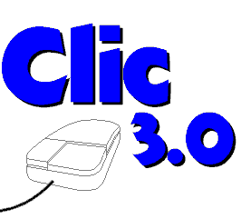

# Clic 3.0
Authoring tool for educational activities, precursor to [JClic](https://projectes.xtec.cat/clic)



## What is this?

"Clic" is an older authoring tool of educational activities created in 1992 by [Francesc Busquets](https://github.com/frncesc). This is an application for 16-bit Windows architecture that only works on older versions of this operating environment (3.1, 95, 98, NT and XP).

The goal of this software repository is only to preserve the source code as part of the history of the Clic project.

In 2002, [JClic](https://projectestac.github.io/jclic) (developed in Java) replaced Clic. All applications created with the original application could be imported by this new authoring tool.

Currently, all educational activities created with Clic and JClic can be run directly in a web browser thanks to the [JClic.js](https://projectestac.github.io/jclic.js) software, developed in JavaScript.

Today, more than 150,000 educational activities created with Clic and JClic by teachers from all over the world, grouped into 2,600 thematic packages, are publicly available in the [public library of JClic projects](https://projectes.xtec.cat/clic/en/repo).

All applications in the project ([Clic](https://github.com/frncesc/clic), [JClic](https://github.com/projectestac/jclic), [JClic.js](https://github.com/projectestac/jclic.js) and [jclic-repo](https://github.com/projectestac/jclic-repo)) are released under free software licenses.

## How can we launch this software today?

To run "Clic" you will need to install a Windows 3.1-XP operating system. We recommend using [Wine](https://www.winehq.org/), which is available for Linux and MacOS, or a similar emulator system.

You will also need the executable files, which can be found in the [Releases](../../releases/) section of this repository. These files are packaged in different ZIP files, one for each available language, along with a collection of sample activities.

To run the program, unzip the ZIP file of your choice to any directory and run this command:

```bash
$ wine clic.exe
```

For more details on how the program works, see the documents in the "/docs" directory.

## History

You will find the story of the origin and evolution of the Clic project explained on [this page of the Clic Zone portal](https://projectes.xtec.cat/clic/en/history/) (available also in [Catalan](https://projectes.xtec.cat/clic/ca/history/) and [Spanish](https://projectes.xtec.cat/clic/es/history/)).

You may also be interested in knowing the history of "[Music](https://github.com/frncesc/music)", an even older project by the same author.

## How to navigate the source code

All the source files are in `/src/clic`. 

If you want to compile the files or modify them for testing, you will need a Windows environment capable of supporting 16-bit applications. In this case, we recommend using [VirtualBox](https://www.virtualbox.org/) and a [Windows XP OVA image](https://archive.org/details/virtual-box).

The "Clic" program was created primarily with [Borland C++ 4](https://winworldpc.com/product/borland-c/40), although [Borland Turbo Assembler](https://winworldpc.com/product/turbo-assembler/20) and [Microsoft Visual Basic 3](https://winworldpc.com/product/microsoft-visual-bas/30) were also used for the utilities. The installers were built with [Wise Install 5.0](https://winworldpc.com/product/wise-installmaster/5x).

The core Borland C++ 4 files are included in this repository (in the `tools/bc4` and `tools/bc4rtl` directories). If you want to use any of the other applications, you will need to download and install them on your virtual Windows XP image.

The application has absolute paths linked to the "D:" drive that are hardcoded in the source code and build scripts. You will therefore need to use the "Shared folders" feature of VirtualBox to mount the "D:" drive of your virtual machine pointing to the `drive_d` directory of the repository. To do this, you will probably need to [change the CD-ROM drive letter](https://uk.pcmag.com/help/96701/change-drive-letters-in-windows-xp) in Windows XP first.

Using Windows XP File Manager, locate the `bcw` file in the `D:\bc4\bin` folder and double-click it to launch it. A couple of warnings will appear that you can ignore. Once inside the Borland C++ IDE, go to the `Project - Open project...` menu and open the `D:\c30\clic\clic.ide` file.

From here, you can edit the C++ source code files of the application, and use the `compile`, `build` or `make` options that are displayed both in the `Project` menu and when clicking on the nodes with the right mouse button. You can also start the program with `CTRL+F9` or from the "lightning" button on the toolbar.

To edit and compile other file types (`.asm`, `.vbx`, `.frm`, `.bas`, `.mak`...) you will need to install the aforementioned programming tools first. To open `.wse` files you will need _Wise Installer 5_.

